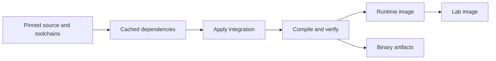

# Building

One [multi-stage Dockerfile](../build/Dockerfile) builds patched Teleport and
produces separate runtime, lab, and artifact targets. It uses Debian Bookworm
for compilation and Debian slim for the runtime. No prebuilt Teleport image or
separate builder image is required.

Source is pinned to Teleport v18.10.0 at
`ddaa46b8f4ee579d43480cd2d3b6a14b18e3ef7d`. The source pin lives in
`integration/upstream.commit`; source/toolchain versions and image digests are
checked during the build.

## Runtime image

Run from the repository root with Docker BuildKit, Buildx, and Compose v2:

```sh
make build
```

This builds `teleport-zitadel:18.10.0`. It contains the patched server, embedded
Web UI, `tctl`, the descriptor helper, required runtime libraries, license, and
build manifest. Source, compilers, Node.js, Rust, and JavaScript dependencies
remain in build stages. The entrypoint is `/usr/local/bin/teleport`; the default
command is `start --config=/etc/teleport.yaml`.

Mount the server configuration at `/etc/teleport.yaml` and persist its configured
data directory, normally `/var/lib/teleport`. The built-in Zitadel integration
is enabled; connector settings are [native resources](configuration.md).

## Lab image

```sh
make lab-build
make lab
```

`make lab-build` exports both runtime and lab images in one Buildx Bake graph,
sharing compilation and verification even if Docker would evict intermediate
stages between separate builds. The target definitions live in
[`build/docker-bake.hcl`](../build/docker-bake.hcl).

`teleport-zitadel-lab:18.10.0` extends the same runtime with `tsh`, the mock IdP,
Python, OpenSSL, curl, and local setup/check scripts. The mock and real Compose
environments use this target. `make lab` and `make real-lab` reuse an existing
image for the selected version and platform, building it when missing. Run
`make lab-build` after source changes. Startup does not compile an unmodified
Community image first.

See [development](development.md) for environment switching and integration
checks. Executables in both images are installed under `/usr/local/bin`.

Measured Linux amd64 sizes on the local Docker engine, including unpacked
layers, after starting each image:

| Image | Docker-reported size |
| --- | --- |
| Production runtime | 739 MB |
| Development lab | 977 MB |
| Previous AlmaLinux lab | 8.49 GB |

Compressed transfer sizes are smaller. The runtime and lab share their server
layers; the lab is about 88% smaller than its predecessor. Compiler caches
remain separate from these image sizes.

## Build stages and caching



The common stages fetch the source, install pinned toolchains, cache native
WebAssembly tools and JavaScript dependencies, and apply the reviewed patch
series before compilation. Upstream `make full FIDO2=off` builds all six
executables and embeds the Web UI and Linux session helper. Rust Desktop, PAM,
BPF, and the `tsh` Rust decoder are retained.

Go modules, Debian-native Go/Rust outputs, Cargo downloads, WebAssembly tools,
and the pnpm store use BuildKit caches. Native output caches are separate from
the previous AlmaLinux build. JavaScript dependencies are installed before our
integration files, so adapter/UI edits can reuse that layer.

The first build compiles the native toolchain dependencies. Later builds reuse
retained stages and compile affected code. Docker's cache storage limits can
evict these stages; the compiler cache is much larger than the final runtime.
Compiler concurrency defaults to 2, and the default target is Linux amd64:

```sh
BUILD_JOBS=4 make build
BUILD_PLATFORM=linux/arm64 make build
```

Verification runs Go test packages serially with race detection enabled and
omits DWARF from temporary test binaries. All Go suites use the upstream
test target and its native feature tags, so upstream and integration tests
reuse the same race-instrumented dependencies. Runtime stack traces remain
available. This reduces concurrent linker output and duplicate cache entries.

The compiler caches, source layers, native dependencies, and temporary linker
files can consume far more disk than the exported image or archive. A host
`df` reading before the build does not describe free space at peak usage.
Verification logs filesystem space and inodes for its source, temporary,
Go-cache, and output paths before each suite and on exit in
`test-results/disk-usage.log`. These details are also printed in the build log,
so they remain visible when a failed stage prevents artifact export.

Each requested platform is compiled natively in its build environment; an
arm64 host can emulate the amd64 build. Platform support must be verified on
the requested target rather than inferred from a successful amd64 build.

## Checks and exports

Every runtime/lab build depends on the verified stage. It checks binary
checksums, versions, and native feature tags; starts an isolated Auth/Proxy;
fetches embedded UI assets; and runs selected upstream, adapter, bridge, and
account-label tests. To build that stage explicitly:

```sh
make build-test
```

This optional debugging image retains the toolchain. Use the runtime or lab
target for running services.

Each Go suite exports JUnit and JSON reports under
`test-results/<suite>/`. The `PASSED` marker is written only after every Go
suite, the smoke check, and the Web UI tests succeed.

```sh
make artifacts
```

The artifact target exports all six binaries, `LICENSE`, `SHA256SUMS`,
`manifest.json`, and test reports to ignored `dist/linux-amd64/` by default.
The manifest records source, toolchains, architecture, binary checksums, and
integration source hashes. Exported Linux binaries use the Debian build's
runtime ABI; the container supplies matching libraries.

## Release CI

[Build Teleport and tsh clients](../.github/workflows/build-linux-amd64.yml)
is manually dispatched. Its Linux job runs `make artifacts`, using the same
Debian toolchains, source preparation, patched Web UI, and verification stage
as local container builds. Windows amd64 and macOS arm64/amd64 `tsh` clients
continue to build natively against the same upstream commit.

The requested tag must resolve to `integration/upstream.commit`; unsupported
tags fail before build jobs start. Before packaging, the release verifier
checks the version, commit, platform, all six binary hashes, passing test marker,
and every recorded integration hash against the current adapter and patches.
The workflow publishes archives and checksums only after Linux and all native
client jobs succeed.

Each publication creates a numbered release, such as
`v18.10.0-build.42.1`, with a title ending in `(build 42.1)`. The numbers are
the workflow run number and run attempt; numbering is workflow-wide rather
than restarting for each Teleport version. A new dispatch increments the run
number, and rerunning a workflow increments the attempt. Archive and checksum
filenames also include `-build.42.1`, while the binaries retain the upstream
Teleport version.

Each release tag targets the build repository commit used by that run, and
the generated notes record the upstream commit, build repository commit, and
release build number. Existing releases, tags, notes, and assets are preserved;
if a release tag already exists, publication fails rather than replacing it.

The Linux build and release jobs default to GitHub-hosted `ubuntu-24.04`.
The `runner` dispatch input accepts a JSON array of labels to select another
runner, such as `["self-hosted", "linux", "x64"]`.

The hosted Linux build removes preinstalled host toolchains that are unused
by container compilation, including the hosted tool cache. This cleanup runs
only on GitHub-hosted runners. After the build, filesystem and Docker cache
usage are uploaded with the test reports, including when verification fails.

The Linux runner needs Make, Python 3, Docker access, and Buildx Bake with a
Linux amd64 Docker engine. Compilers and native development packages are
provided by the Docker build. Persistent BuildKit caches on a self-hosted
runner can be reused across releases. Exported upstream reports come from
`dist/linux-amd64/test-results/`; focused integration test results also appear
in the build log. A failed verification stage does not export artifacts.

Zitadel support is enabled by default in both Linux archives and container
images. Configure a [native connector](configuration.md) to use it. Container
registry publication is separate from archive release publishing.

[Adapter CI](../.github/workflows/test-oidc-adapter.yml) runs standalone race
tests and vet. [Patch CI](../.github/workflows/check-teleport-patches.yml)
checks source preparation against the supported upstream commit.
